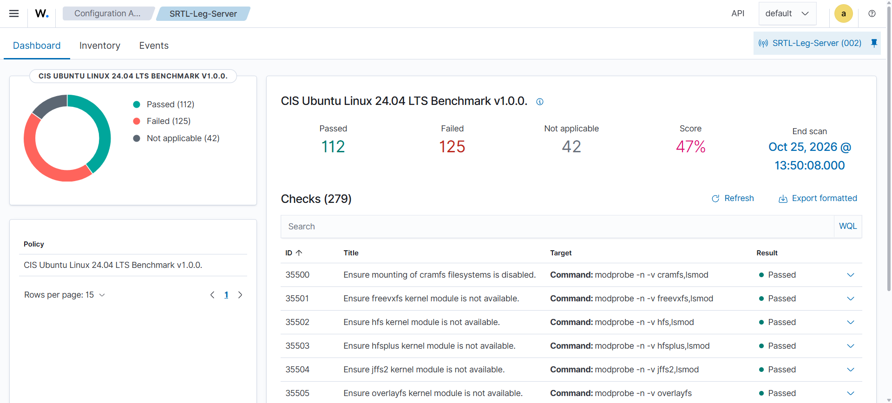
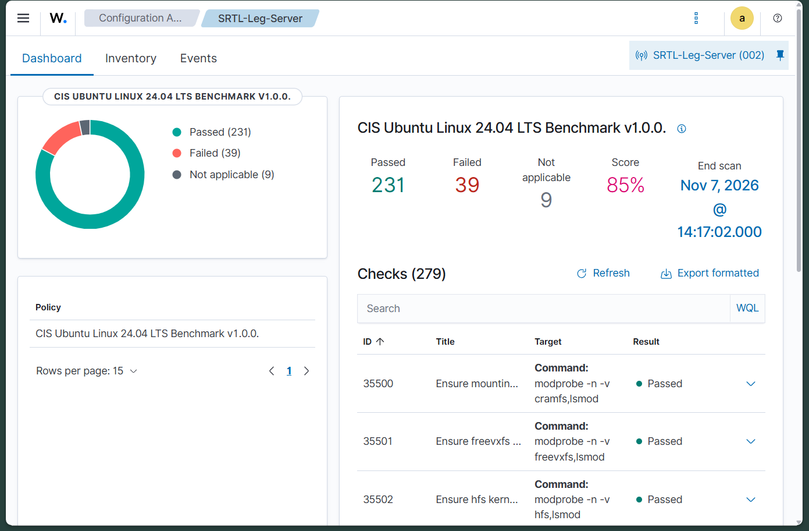
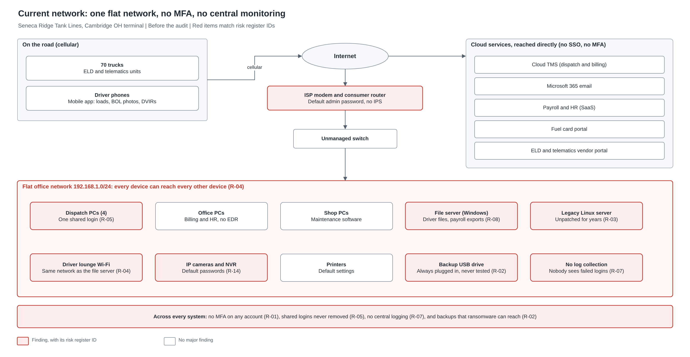
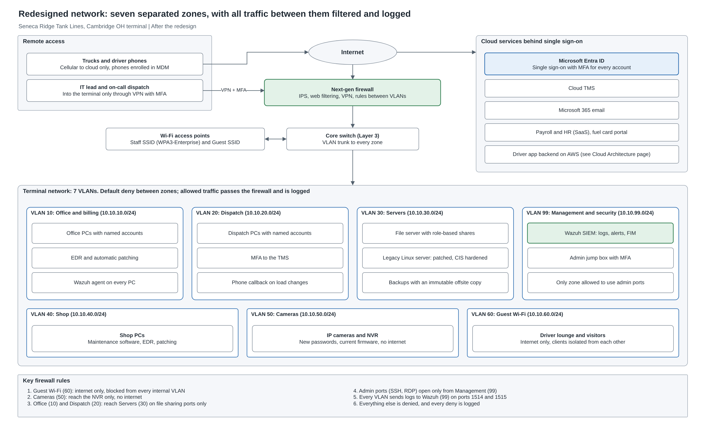
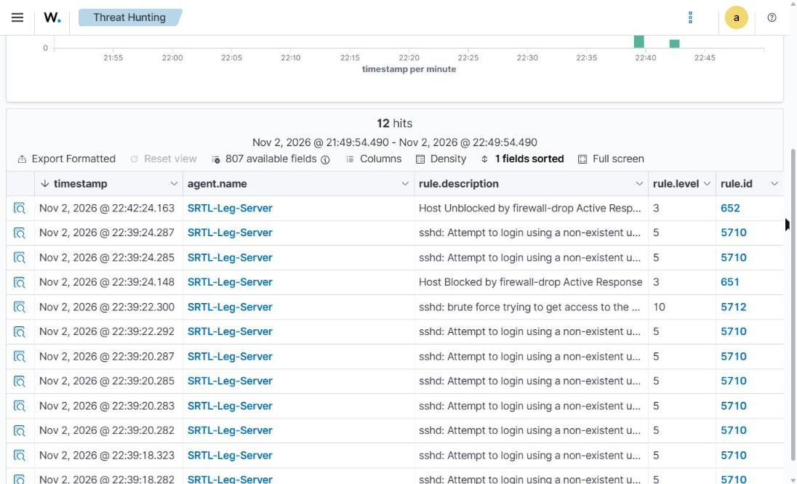

# Seneca Ridge Tank Lines: Security Audit and Hardening

Full security audit of a fictional HazMat tanker carrier, with hands-on hardening and testing of its legacy Linux server in a home lab. This is my capstone for the Coding Temple Cybersecurity Program (Module 9), presented live in November 2026 and scored 95/100.

**Francisco Juarez** · [LinkedIn](https://www.linkedin.com/in/franciscojuarez02/)

> Seneca Ridge Tank Lines is a made-up company. No real organization's systems were tested. All testing ran on virtual machines on an isolated VirtualBox network.

## Results at a glance

| Measure | Before (Oct 25) | After (Nov 7) |
|---|---|---|
| CIS Ubuntu 24.04 benchmark | 47% (125 failed checks) | **85%** (39 failed, each accepted with a reason) |
| Pending updates | 27 | **0** |
| Host firewall | Off | **Default deny**, incoming and outgoing |
| Network exposure | SSH open on every interface | **Only port 22, only from the admin workstation** |
| SSH login | Passwords and root key login allowed | **Key only**, root off, one allowed user, warning banner |
| Passwords and lockout | No rules, empty passwords accepted | **14+ characters**, lockout after 5 failures, last 24 blocked |
| Audit logging | Not installed | **auditd with 73 rules** |
| File change detection | Wazuh scan every 12 hours | **Real-time alerts** on SSH and sudo settings, daily AIDE check |
| Brute-force response | Alert only | **Source blocked about 2 seconds after the alert**, released after 3 minutes |
| Log retention | Kept until the disk fills | **90 days searchable**, archives kept 1 year |

| CIS score before: 47% | CIS score after: 85% |
|---|---|
|  |  |

## What the project covers

- **Risk assessment:** 15-risk register scored by likelihood and impact, with affected assets, owners and treatments, mapped to NIST CSF 2.0.
- **Network redesign:** one flat network replaced by seven filtered VLAN zones behind a next-generation firewall.
- **Cloud design:** AWS architecture for the dispatch system (private subnets, KMS, CloudTrail, GuardDuty, Security Hub). Design only, not deployed.
- **Hands-on hardening:** the legacy Ubuntu server, taken from 47% to 85% on the CIS benchmark in two phases, with every command logged.
- **Monitoring:** Wazuh 4.14 SIEM with CIS checks, vulnerability detection, real-time file integrity monitoring and active response.
- **Testing:** Nmap scans, firewall and SSH bypass attempts, file tampering tests and a simulated brute-force attack.
- **Incident response:** IR plan based on NIST SP 800-61 Rev. 3 with three playbooks, plus a phishing tabletop exercise that found 14 gaps.
- **Governance:** information security policy, security roles org chart and a mitigation roadmap (30 days, 90 days, 12 months).

## Lab setup

| Machine | Address | Role |
|---|---|---|
| Wazuh-Server (Ubuntu Server 24.04, Wazuh 4.14) | 192.168.56.10 | SIEM: log collection, alerts, FIM, CIS checks, vulnerability detection |
| SRTL-Leg-Server (Ubuntu Server 24.04.5) | 192.168.56.20 | Legacy server under test, Wazuh agent 002 |
| Admin laptop (Windows 11) | 192.168.56.1 | Admin workstation and test attacker, Wazuh agent 001 |

All test traffic stayed on a VirtualBox host-only network. Each change followed the same loop: record the baseline, snapshot the VM, make the change, log the command, rescan and test that the control works.

## Architecture

**Current network:** one flat network, no MFA, no central monitoring.

**Redesigned network:** seven VLAN zones, default deny between zones.

More diagrams: [cloud architecture](diagrams/3_Cloud_Architecture_AWS.png), [security architecture](diagrams/4_Security_Architecture.png), [data flow](diagrams/5_Data_Flow.png), [security org chart](diagrams/6_Security_Org_Chart.png). The draw.io source is [here](diagrams/Seneca_Ridge_Diagrams.drawio).

## Brute-force test

Ten SSH login attempts as a non-existent user from the laptop. Wazuh rule 5712 fired, the agent blocked the source about 2 seconds later (rule 651) and lifted the block after 3 minutes (rule 652). The active response config is in [configs/wazuh](configs/wazuh/active-response.xml).

## Repository contents

| Folder | What's in it |
|---|---|
| [report](report) | [Full audit report (PDF)](report/Seneca_Ridge_Security_Audit_Report.pdf), [presentation slides](report/Capstone_Presentation.pdf), [project proposal](report/Project_Proposal.pdf) |
| [docs](docs) | Requirements, risk register, hardening plan, security policy, incident response plan, mitigation strategy, before and after comparison |
| [diagrams](diagrams) | Six architecture diagrams and the draw.io source |
| [configs](configs) | SSH hardening file, ufw firewall rules, Wazuh active response and real-time FIM settings |
| [evidence](evidence) | 47 dated screenshots, Nmap output, CIS scan exports and the full [command log](evidence/Command_Log.txt) |

Screenshots are named `date_number_stage_subject`, so `2026-10-25_07_before_CIS-47.png` is the baseline CIS score. The report's Appendix B maps each result to its evidence file.

## Tools and frameworks

Wazuh · Ubuntu Server · ufw · OpenSSH · auditd · AIDE · Linux PAM (faillock, pwquality, pwhistory) · AppArmor · Nmap · VirtualBox · draw.io · NIST CSF 2.0 · NIST SP 800-61 Rev. 3 · CIS Ubuntu Linux 24.04 Benchmark v1.0.0 · MITRE ATT&CK · PHMSA security plan rules (49 CFR 172.800 to 172.804)

## Recommendations to the company

1. **Within 30 days:** MFA on email, the TMS, load boards, the fuel card portal and payroll; a phone callback on every load change; a unique login for every dispatcher.
2. **Within 90 days:** split the network into VLANs, add endpoint protection, set up immutable or offline backups, extend Wazuh to every office PC and the file server, and run the first full team tabletop.
3. **Within 12 months:** retire or replace the legacy server (every remaining vulnerability finding sits on its kernel, which is already the newest Ubuntu offers) and add security terms to vendor contracts.
